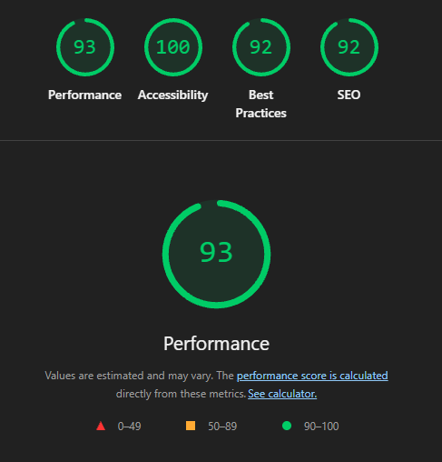
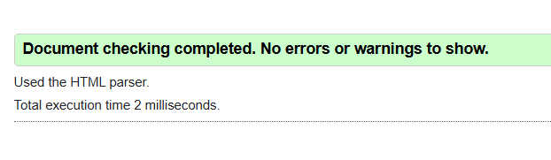

# Nordic Future 2027

En fiktiv konferenswebbplats med fokus på teknik, innovation och framtidens möjligheter.

## Om projektet

Nordic Future 2027 är en responsiv webbplats för en påhittad konferens i Stockholm den 21 maj 2027.

Webbplatsen innehåller:

- Information om konferensen
- Konferensprogram
- Presentation av talare
- Biljettalternativ
- Praktisk information och karta

## Tekniker

- HTML
- Sass (SCSS)
- JavaScript
- Vite

## CSS och namngivning

Projektet använder Sass för att organisera och strukturera CSS-koden.

CSS-klasserna använder en konsekvent namngivning inspirerad av BEM (Block, Element, Modifier).

Exempel:

- `speaker-card`
- `speaker-role`
- `ticket-card`
- `ticket-featured`

## Responsiv design

Webbplatsen är anpassad för:

- Mobil
- Surfplatta
- Desktop

## Tillgänglighet

Webbplatsen använder:

- Semantisk HTML
- Synlig tangentbordsfokus med `:focus-visible`
- Hover-effekter som även fungerar med tangentbord
- Stöd för minskad rörelse med `prefers-reduced-motion`

## Lighthouse – Mobile

Resultat från Lighthouse-test:

## HTML Validation

HTML-koden har kontrollerats med W3C HTML Validator.

Resultat: 0 errors.

## AI-användning

AI har använts som stöd under utvecklingen för att diskutera kodstruktur, Sass, responsiv design och tillgänglighet.

Koden har granskats och anpassats under arbetets gång.
